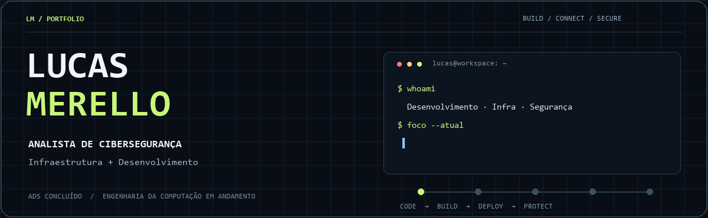
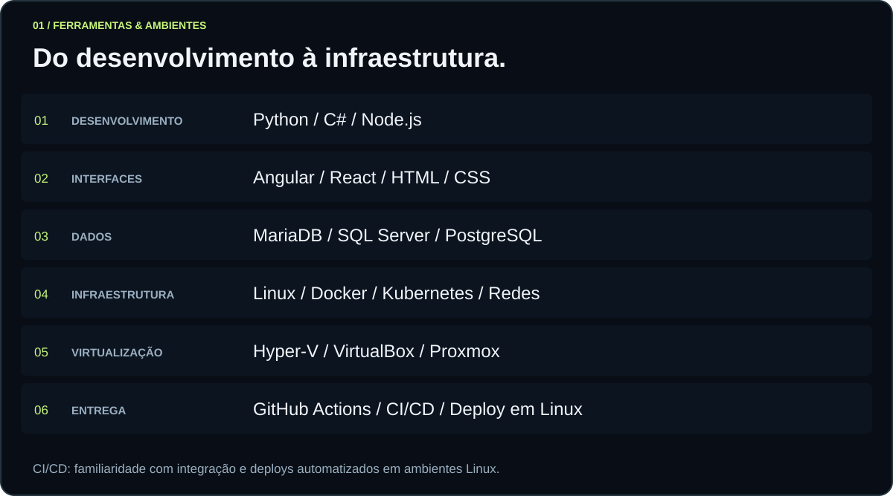
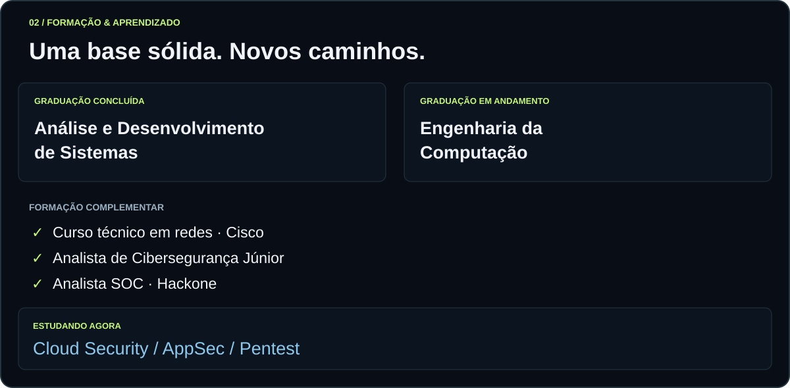
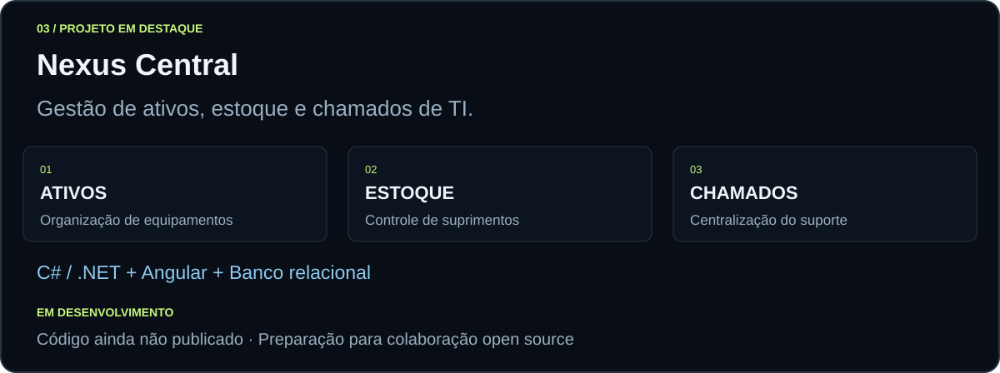

### Da operação ao código. Do código à segurança.

Sou formado em **Análise e Desenvolvimento de Sistemas** e curso **Engenharia da Computação**. Minha trajetória passa por **Suporte de TI → Desenvolvimento Full Stack → Análise de Redes**. Atualmente, atuo como **Analista de Cibersegurança**, com foco em **infraestrutura e desenvolvimento**.

Essa experiência conecta a construção de aplicações aos ambientes em que elas rodam: **redes, Linux, virtualização, containers e automação de deploys**.

 

  

  

Meu foco no Nexus é evoluir o projeto, documentar decisões técnicas e preparar o caminho para contribuições da comunidade.

 

[**Acompanhe meus projetos e estudos ↗**](https://github.com/LucasMerello?tab=repositories)

Construir · Conectar · Automatizar · Proteger

